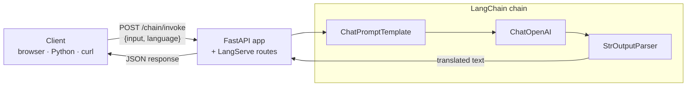

# GenAI Translation API with FastAPI and LangServe

A small **generative AI web service** that translates text into any language using an OpenAI model. A LangChain chain is built and then served as a **REST API** with **FastAPI** and **LangServe**, so any app, script or frontend can call it over HTTP.

The project shows the step from experimenting in a notebook to **deploying an LLM chain as an API**.

---

## Features

- **Translate into any language:** pass the text and the target language as inputs
- **LCEL chain:** `prompt | llm | parser` built with the LangChain Expression Language
- **Ready-made endpoints** from LangServe: `invoke`, `batch` and `stream`
- **Interactive playground** in the browser for testing without writing code
- **Auto-generated API docs** (Swagger UI) from FastAPI
- **API key kept out of the code:** it's loaded from a `.env` file that is git-ignored

---

## How it works



### The chain

```python
prompt = ChatPromptTemplate.from_messages([
    ("system", "translate the following into {language}"),
    ("user", "{input}")
])

chain = prompt | llm | parser
```

| Component | Role |
|---|---|
| `ChatPromptTemplate` | Fills `{language}` into the system instruction and `{input}` into the user message. |
| `ChatOpenAI` | Sends the prompt to the OpenAI model and returns its reply as a message object. |
| `StrOutputParser` | Pulls out the plain text of the reply, so the API returns a clean string. |

The `|` operator (LCEL) passes each component's output into the next one.

### Serving it

```python
app = FastAPI(title="langchain server", version="1.0",
              description="API server using langchain runnable interfaces")

add_routes(app, chain, path="/chain")
```

LangServe's `add_routes` turns the chain into a set of REST endpoints under `/chain`, with input and output validation included.

---

## API endpoints

When the server is running on `http://localhost:8000`:

| Endpoint | Method | Description |
|---|---|---|
| `/chain/invoke` | POST | Translate a single input |
| `/chain/batch` | POST | Translate several inputs in one request |
| `/chain/stream` | POST | Stream the translation token by token |
| `/chain/playground/` | GET | Browser UI for trying the chain |
| `/docs` | GET | Swagger UI with all endpoints and schemas |

---

## Example

**Request**
```bash
curl -X POST http://localhost:8000/chain/invoke \
  -H "Content-Type: application/json" \
  -d '{"input": {"input": "Welcome home!", "language": "German"}}'
```

**Response**
```json
{
  "output": "Willkommen zu Hause!",
  "metadata": { "...": "..." }
}
```

The outer `"input"` key is LangServe's request wrapper. The inner object holds the chain's own variables: `input` (the text) and `language`.

**From Python**
```python
import requests

response = requests.post(
    "http://localhost:8000/chain/invoke",
    json={"input": {"input": "Good morning, how are you?", "language": "Swahili"}},
)
print(response.json()["output"])
```

**Or with LangServe's client**, which lets you call the remote chain as if it were local:
```python
from langserve import RemoteRunnable

chain = RemoteRunnable("http://localhost:8000/chain/")
print(chain.invoke({"input": "Thank you very much", "language": "French"}))
```

---

## Project structure

```
.
├── serve.py           # FastAPI + LangServe app (the API server)
├── serve.ipynb        # Notebook used to build and test the chain first
├── requirements.txt   # Python dependencies
├── .gitignore         # Keeps .env, .vscode/ and env folders out of Git
└── README.md
```

---

## Getting started

### 1. Clone the repository
```bash
git clone https://github.com/Paulokw/GEN-AI-App-with-FASTAPI.git
cd GEN-AI-App-with-FASTAPI
```

### 2. Create and activate a virtual environment
```bash
python -m venv venv
# Windows
venv\Scripts\activate
# macOS / Linux
source venv/bin/activate
```

### 3. Install dependencies
```bash
pip install -r requirements.txt
```

### 4. Add your OpenAI API key
Create a `.env` file in the project root:
```env
OPENAI_API_KEY=your_openai_api_key
```
Get a key at <https://platform.openai.com/api-keys>.

### 5. Start the server
```bash
python serve.py
```
Then open:
- **Playground:** <http://localhost:8000/chain/playground/>
- **API docs:** <http://localhost:8000/docs>

---

## Tech stack

- [FastAPI](https://fastapi.tiangolo.com/): web framework for the API
- [LangServe](https://github.com/langchain-ai/langserve): exposes LangChain runnables as REST endpoints
- [LangChain](https://python.langchain.com/): prompt templates, LCEL chains and output parsers
- [OpenAI](https://platform.openai.com/): the LLM that does the translation
- [Uvicorn](https://www.uvicorn.org/): ASGI server that runs the app
- [python-dotenv](https://pypi.org/project/python-dotenv/): loads the API key from `.env`

---

## Possible extensions

- Add a simple **frontend** (Streamlit, or HTML + JavaScript) that calls the API
- Serve **several chains** from one app (e.g. `/translate`, `/summarise`) with more `add_routes` calls
- Add **authentication** (an API key header) before deploying publicly
- **Containerise** with Docker and deploy to Render, Railway or a cloud VM
- Let callers choose the model or temperature through the request
